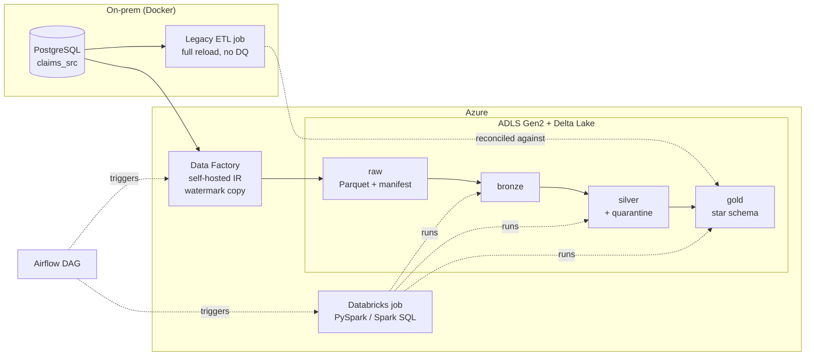

# Healthcare Claims ETL Modernization: On-Prem PostgreSQL to Azure Databricks

An end-to-end data engineering project that migrates a legacy on-prem claims ETL job to a cloud data platform on Azure. Azure Data Factory copies data incrementally from an on-prem PostgreSQL database into ADLS Gen2, Azure Databricks builds **bronze, silver and gold Delta Lake layers** with PySpark and Spark SQL, and Apache Airflow orchestrates the whole pipeline.

The data is the CMS **DE-SynPUF** synthetic Medicare dataset: 116,352 patients and 857,563 inpatient and outpatient claim rows from 2008 to 2010, loaded as three yearly batches.



## Results (local run of all three batches)

| | |
|---|---|
| Claims processed | **846,242** claims from 857,563 source rows (11,043 continuation segments consolidated) |
| Quarantined | **278** orphan claim segments with no dates, caught and kept, not dropped |
| Patient history | **307,290** SCD Type 2 versions for 116,352 patients (190,937 tracked changes) |
| Data quality | 16 rules per run: 14 pass, 2 warnings recorded (2,611 negative-payment adjustments, 50 claims with no primary diagnosis) |
| Reconciliation | 17 checks per batch, all passing; **$863,795,510.00** of payments matched to the cent from source → bronze → silver → gold and against the legacy report |
| Incremental loads | Each batch extracts only rows changed since the last watermark, including 531 simulated late adjustments per year |
| Performance tuning | Broadcast joins cut the fact table build from **17.9 s to 6.8 s (62% faster)**; fact table partitioned by year and Z-ordered |
| Tests | 19 unit tests (PySpark + Delta) |

## What the pipeline does

**1. On-prem source and legacy job** ([onprem/](onprem))
PostgreSQL in Docker holds beneficiaries and claims, with an `updated_at` column, a watermark control table, and the legacy ETL job: a nightly `TRUNCATE` + `INSERT` that rebuilds a monthly summary with no data quality checks and double-counts split claims.

**2. Incremental ingestion** ([adf/](adf), [ingestion/](ingestion))
The ADF pipeline loops over the source tables. For each one it reads the old and new watermark, copies only the changed rows to `raw/<table>/batch_id=<batch>/` as Parquet, writes a manifest with the source row count and payment total, and then moves the watermark forward. A self-hosted integration runtime connects ADF to the on-prem database. `ingestion/extract_incremental.py` does exactly the same locally.

**3. Bronze** ([src/claims_etl/bronze.py](src/claims_etl/bronze.py))
Raw files become Delta tables partitioned by batch, with load metadata. Every version of every row is kept, and rerunning a batch replaces its partition.

**4. Silver** ([src/claims_etl/silver.py](src/claims_etl/silver.py))
- Inpatient and outpatient claims mapped to one layout
- Latest version of each claim segment kept, so source adjustments overwrite old values
- Claims split into two segments consolidated into one row: header fields from segment 1, amounts summed
- Dates parsed, ICD-9 codes normalised, codes decoded
- Invalid claims sent to a **quarantine** table with the reason
- Delta `MERGE` upserts, so reruns never duplicate data

**5. Gold** ([src/claims_etl/gold.py](src/claims_etl/gold.py), [src/claims_etl/scd2.py](src/claims_etl/scd2.py))
A star schema ([docs/data_model.md](docs/data_model.md)):
- `fact_claims`: one row per claim, partitioned by `claim_year`
- `dim_patient`: **SCD Type 2**, a new version when chronic conditions, ESRD, death or coverage change
- `dim_provider`, `dim_diagnosis` (with ICD-9 chapters) and `dim_date`
- `bridge_claim_diagnosis`: every diagnosis on a claim

Facts look up the patient version that was valid **on the claim date**, and unknown members (`-1`) make sure no fact row is lost.

**6. Data quality and reconciliation** ([src/claims_etl/quality.py](src/claims_etl/quality.py), [src/claims_etl/reconcile.py](src/claims_etl/reconcile.py))
- **Data quality rules:** null, uniqueness, range and SCD-integrity rules. Error-level failures stop the pipeline.
- **Reconciliation:** source → bronze → silver → gold row counts and payment totals, plus legacy vs new. The new pipeline counts 10,975 fewer outpatient claims than the legacy job, and the reconciliation explains that difference: the legacy job counted continuation segments as separate claims.
- **Where results go:** `ops/` Delta tables, together with a per-step run log.

**7. Orchestration** ([airflow/dags/claims_pipeline_dag.py](airflow/dags/claims_pipeline_dag.py), [databricks/jobs/claims_pipeline_job.json](databricks/jobs/claims_pipeline_job.json))
An Airflow DAG runs the ADF pipeline and then a multi-task Databricks job (bronze → silver → gold → quality + reconcile → optimize) on a single-node job cluster.

## Tech stack

Python, SQL, PySpark, Spark SQL, Delta Lake, Azure Data Factory, ADLS Gen2, Azure Databricks, Apache Airflow, PostgreSQL, Docker, pytest

## Run it locally

You need Docker. Everything runs in containers. The local runner uses the same Spark/Delta versions as Databricks Runtime 15.4 LTS.

```bash
git clone https://github.com/siddhidokania/healthcare-claims-etl.git
cd healthcare-claims-etl
cp .env.example .env

python onprem/download_data.py                  # CMS DE-SynPUF Sample 1, about 51 MB
docker compose up -d onprem-db                  # on-prem PostgreSQL on port 5433
docker compose run --rm runner python -m pytest tests
docker compose run --rm runner python -m pipeline.run_local --demo   # 3 yearly batches, about 15 min
docker compose run --rm runner python -m pipeline.report
docker compose run --rm runner python -m pipeline.benchmark_fact_join
```

To run a single batch or step: `python -m pipeline.run_local --batch-id 2009 --steps silver,gold`.

## Run it on Azure

See [docs/azure_setup.md](docs/azure_setup.md): storage account, Key Vault, Data Factory with a self-hosted integration runtime, Databricks with Unity Catalog, and Airflow connections.

## Project structure

```
├── onprem/            source schema, legacy ETL job, data download and yearly loader
├── ingestion/         local watermark-based extract (same logic as ADF)
├── adf/               Data Factory pipeline, datasets, linked services, integration runtime
├── src/claims_etl/    bronze, silver, gold, SCD Type 2, data quality, reconciliation, audit
├── databricks/        notebooks and the multi-task job definition
├── airflow/dags/      orchestration DAG
├── pipeline/          local runner, report and benchmark
├── tests/             unit tests
└── docs/              data model, architecture decisions, Azure setup
```

## Design decisions

See [docs/architecture.md](docs/architecture.md).
